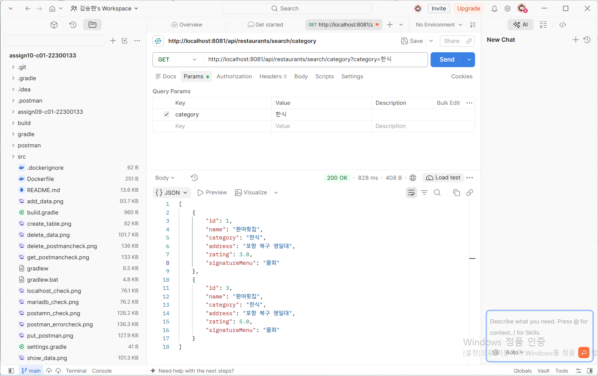
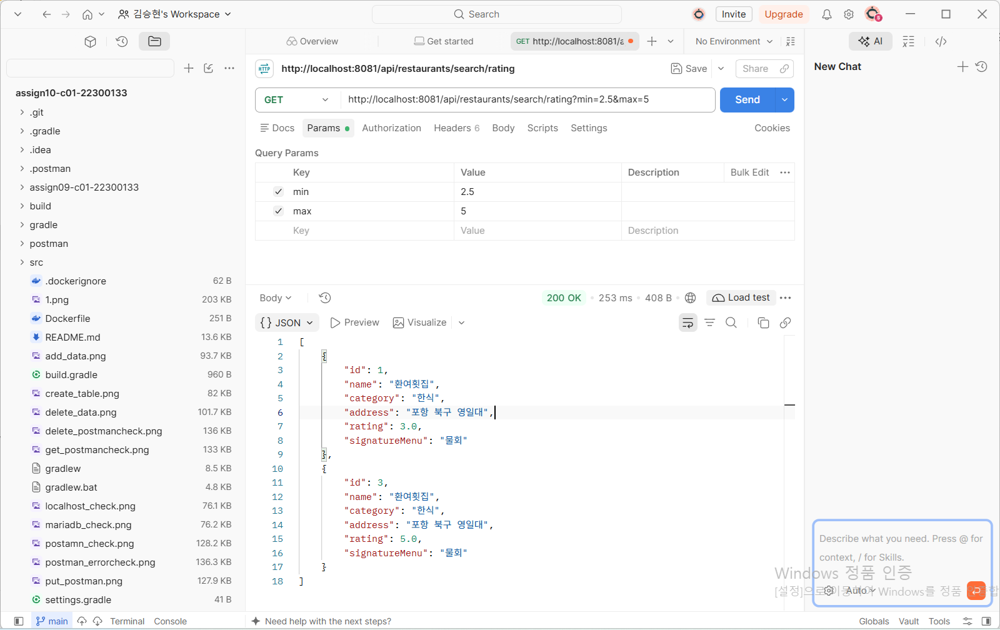
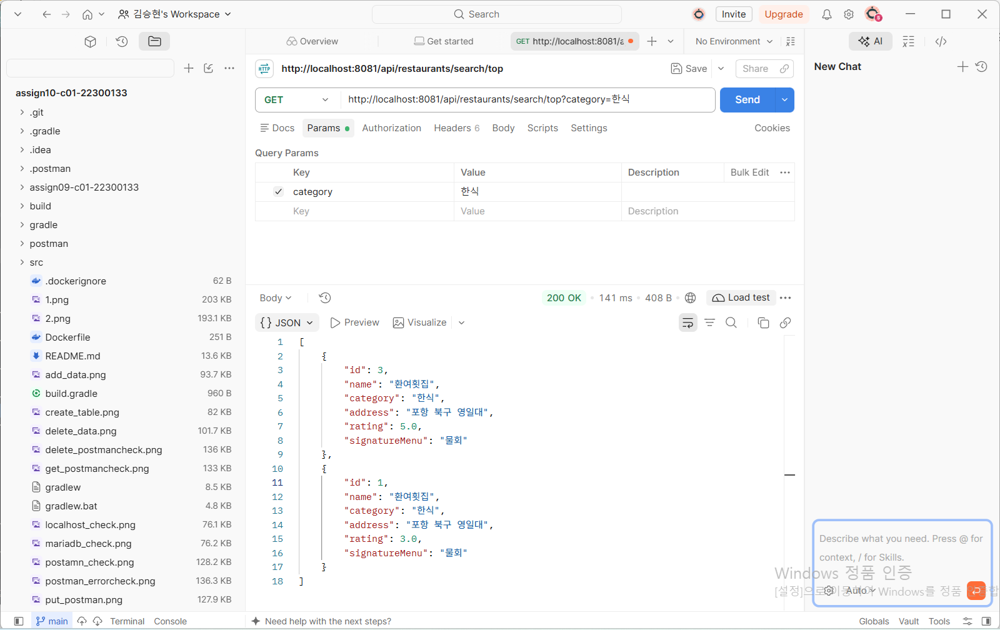
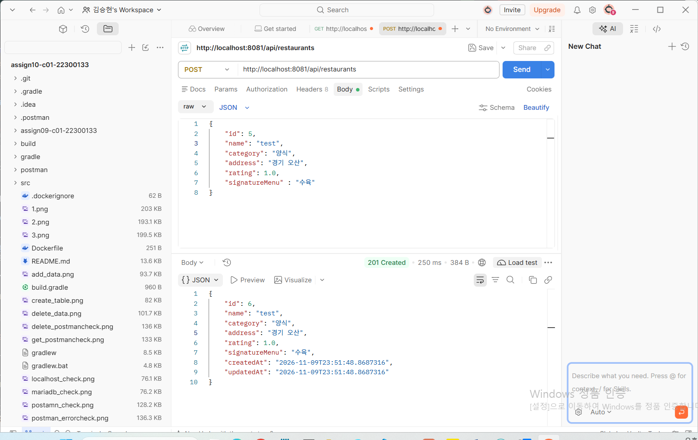

# 맛집 관리 REST API (10주차: Spring Data JPA 응용)

- **GitHub Repository:** https://github.com/2026-2-WebService/assign10-c01-22300133
- **Render Deployment URL:** https://webd-week10.onrender.com/api/restaurants

---

## ① 프로젝트 소개

### 주제 및 주요 기능

9주차에 만든 맛집 관리 REST API를 기반 고쳐서 만들었습니다

- 기존 기능: 맛집 등록, 전체 조회, 단건 조회, 수정, 삭제 (CRUD)
- 
- **10주차 추가 기능**
  - Query Method를 이용한 검색 3개 (카테고리 검색, 평점 범위 검색, 카테고리별 평점 높은 순 정렬)
  - Dirty Checking을 이용한 수정 (`save()` 호출 없이 수정)
  - Auditing을 이용한 생성 시간(`createdAt`)과 수정 시간(`updatedAt`) 자동 기록

### Entity 필드 구조

| 필드 | Java 타입 | 설명 | 비고 |
|---|---|---|---|
| `id` | `long` | 기본키 | 자동 증가 |
| `name` | `String` | 가게 이름 | 필수 |
| `category` | `String` | 카테고리 | 필수 |
| `address` | `String` | 주소 | 필수 |
| `rating` | `double` | 평점 | 필수, 0 이상 |
| `signatureMenu` | `String` | 대표 메뉴 | 필수 |
| `createdAt` | `LocalDateTime` | 생성 시간 | **10주차 추가**, `@CreatedDate` |
| `updatedAt` | `LocalDateTime` | 최종 수정 시간 | **10주차 추가**, `@LastModifiedDate` |

### REST API Endpoint

| Method | URL | 기능 |
|---|---|---|
| POST | `/api/restaurants` | 등록 |
| GET | `/api/restaurants` | 전체 조회 |
| GET | `/api/restaurants/{id}` | 단건 조회 |
| PUT | `/api/restaurants/{id}` | 수정 (Dirty Checking) |
| DELETE | `/api/restaurants/{id}` | 삭제 |
| GET | `/api/restaurants/search/category?category=` | **카테고리 검색** |
| GET | `/api/restaurants/search/rating?min=&max=` | **평점 범위 검색** |
| GET | `/api/restaurants/search/top?category=` | **카테고리별 평점 높은 순** |

---

## ② 주요 구현 내용 및 결과

### 1. Query Method 3개

| 구분 | 메서드 | 실행되는 SQL 조건 |
|---|---|---|
| 단일 조건 | `findByCategory(String category)` | `WHERE category = ?` |
| 복합 조건 (Between) | `findByRatingBetween(double min, double max)` | `WHERE rating BETWEEN ? AND ?` |
| 정렬 | `findByCategoryOrderByRatingDesc(String category)` | `WHERE category = ? ORDER BY rating DESC` |

**① 카테고리 검색:** `GET /api/restaurants/search/category?category=한식`

카테고리가 `한식`인 데이터 2개(id 1, 3)만 조회됩니다.



**② 평점 범위 검색:** `GET /api/restaurants/search/rating?min=2.5&max=5`

평점이 2.5~5.0 사이인 데이터(id 1, 3)만 조회되고, 평점 1.0인 데이터는 제외됩니다.



**③ 카테고리별 평점 높은 순:** `GET /api/restaurants/search/top?category=한식`

같은 한식이라도 평점 5.0인 id 3이 평점 3.0인 id 1보다 먼저 나옵니다.



### 2. Dirty Checking을 이용한 수정

```java
@Transactional
public RestaurantResponse update(Long id, @Valid RestaurantRequest request) {
    Restaurant restaurant = findEntity(id);   // 영속 상태로 조회
    restaurant.update(request);               // 필드 값만 변경
    return RestaurantResponse.from(restaurant); // repository.save() 호출 없음
}
```

- 9주차에는 `repository.save(restaurant)`를 호출했지만, 10주차에는 `save()`를 지우고 `@Transactional`을 붙였습니다.
- PUT 요청을 보내면 콘솔에 `update restaurants set ...` SQL이 실행되고, DBeaver에서도 값이 바뀐 것을 확인했습니다.
- `save()`를 호출하지 않아도 트랜잭션이 끝날 때 JPA가 변경된 필드를 감지해서 UPDATE를 실행합니다.

### 3. Auditing을 이용한 생성·수정 시간 자동 기록

- `@EnableJpaAuditing`: 메인 클래스에 추가해서 Auditing 기능을 켰습니다.
- `@EntityListeners(AuditingEntityListener.class)`: Entity의 저장과 수정 시점을 감지합니다.
- `@CreatedDate` + `@Column(updatable = false)`: 처음 저장할 때만 시간을 기록하고 이후에는 바뀌지 않습니다.
- `@LastModifiedDate`: 저장하거나 수정할 때마다 현재 시간으로 갱신됩니다.

새 데이터를 등록하면 `createdAt`과 `updatedAt`이 같은 시간으로 자동 기록됩니다. 요청 Body에는 시간을 넣지 않았습니다.



기존 데이터를 수정하면 `createdAt`은 그대로이고 `updatedAt`만 수정 시간으로 바뀝니다.

> 기존에 저장되어 있던 데이터(id 1~3)는 컬럼이 나중에 추가되었기 때문에 `createdAt`, `updatedAt`이 `null`입니다.

---

## ③ Weekly Review

### Key Learning

1. **Query Method:** 메서드 이름을 `findBy + 필드명 + 조건` 규칙에 맞게 선언하기만 하면 Spring Data JPA가 SQL을 자동으로 만들어 줍니다. `Between`, `OrderBy...Desc`처럼 조건과 정렬도 이름으로 표현할 수 있습니다.
2. **Dirty Checking:** `@Transactional` 안에서 조회한 엔티티는 영속 상태라서, 필드 값만 바꿔도 트랜잭션이 끝날 때 UPDATE가 자동으로 실행됩니다.
3. **Auditing:** `@CreatedDate`, `@LastModifiedDate`를 쓰면 생성·수정 시간을 직접 넣지 않아도 JPA가 자동으로 기록해 줍니다.

### Problem & Solution

| 문제 | 원인 | 해결 |
|---|---|---|
| 프로젝트를 옮긴 뒤 실행하면 `jdbcUrl, ${DB_URL}` 오류 발생 | 새 실행 설정에 환경변수가 없음 | IntelliJ Run Configuration에 `DB_URL`, `DB_USERNAME`, `DB_PASSWORD` 다시 등록 |
| Auditing 필드 추가 후 모든 조회가 `500` 오류 (`Unknown column 'created_at'`) | Hibernate가 만든 `ALTER TABLE IF EXISTS ...` 문법을 학교 DB(MariaDB 10.1)가 지원하지 않아 컬럼이 자동 생성되지 않음 | DBeaver에서 `ALTER TABLE restaurants ADD COLUMN created_at DATETIME(6), ADD COLUMN updated_at DATETIME(6);`로 직접 추가 |
| PUT/GET 요청이 `404` | URL 끝에 id를 넣지 않음 | `/api/restaurants/{id}` 형태로 수정 |
| PUT 응답의 `updatedAt`이 바뀌지 않음 | Dirty Checking은 메서드가 끝나고 커밋될 때 UPDATE가 실행되므로, 응답을 만드는 시점에는 아직 수정 시간이 기록되지 않음 | PUT 이후 GET으로 다시 조회해서 `updatedAt`이 바뀐 것을 확인 |

### Reflection

9주차에는 수정할 때 `save()`를 직접 불렀는데, 이번에 Dirty Checking을 적용하면서 JPA가 엔티티의 상태를 관리한다는 것을 알게 되었습니다. 또 `ddl-auto=update`가 항상 테이블을 알아서 바꿔 주는 것은 아니고, DB 버전에 따라 실패할 수 있다는 것도 배웠습니다. 앞으로는 콘솔에 찍히는 SQL과 경고 로그를 먼저 확인하는 습관을 들이려고 합니다.

---

## ④ AI Usage

**사용한 도구:** Claude Code

**주요 질문**

- 9주차 프로젝트 폴더를 10주차 저장소로 옮길 때 생긴 push 오류(`src refspec main does not match any`)와 중첩된 `.git` 문제
- 환경변수 누락 오류, `Unknown column 'created_at'` 오류의 원인 분석


**직접 수정·검증한 부분**

- IntelliJ 환경변수 설정, 서버 실행
- Postman으로 검색 API 3개, PUT, POST 테스트 및 결과 캡처
- DBeaver에서 `ALTER TABLE`로 컬럼을 추가하고 저장된 날짜 확인
- Render 배포와 배포 URL 테스트

**AI 사용률 자기 평가:**  30(%)
